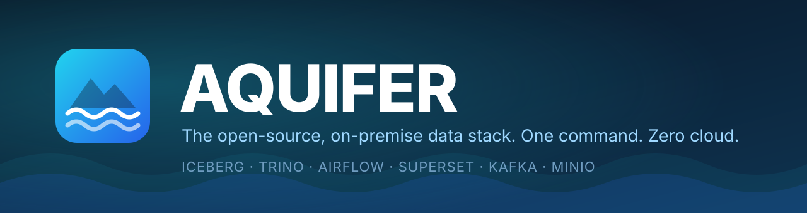
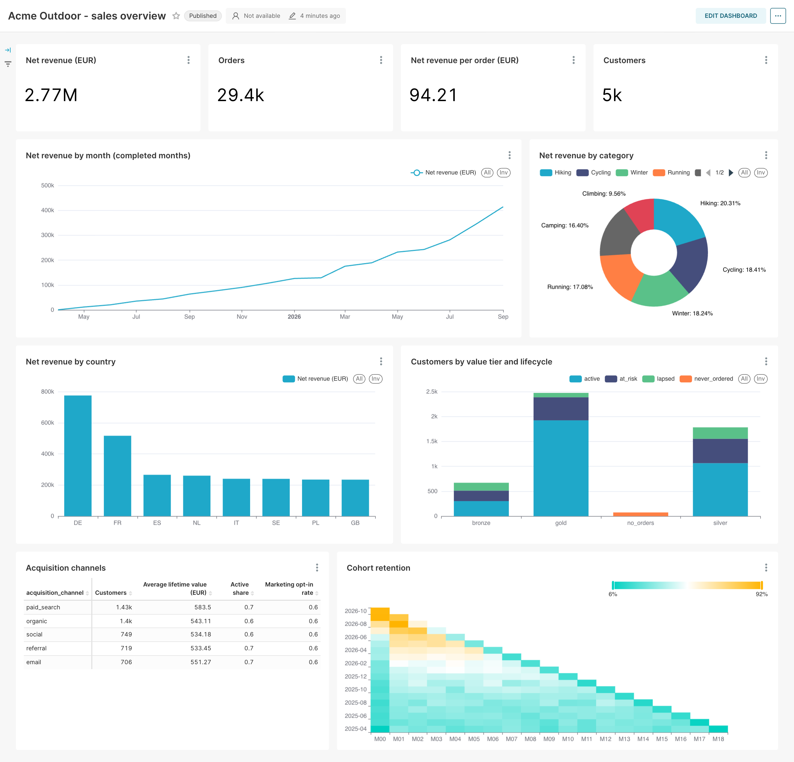
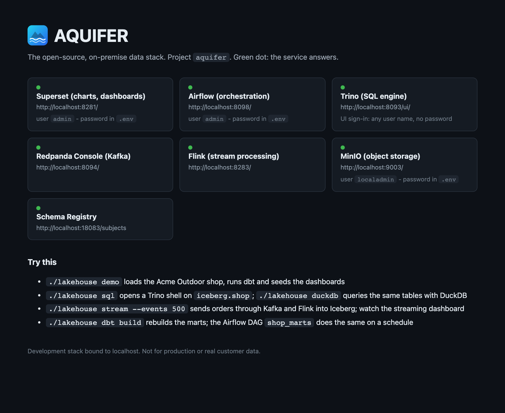
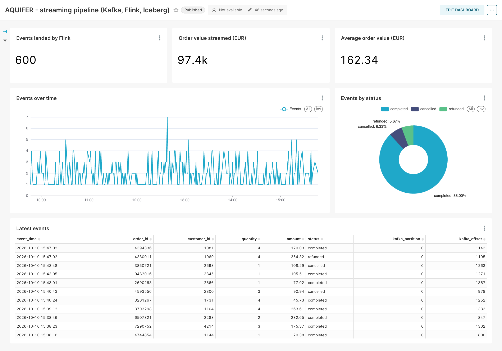
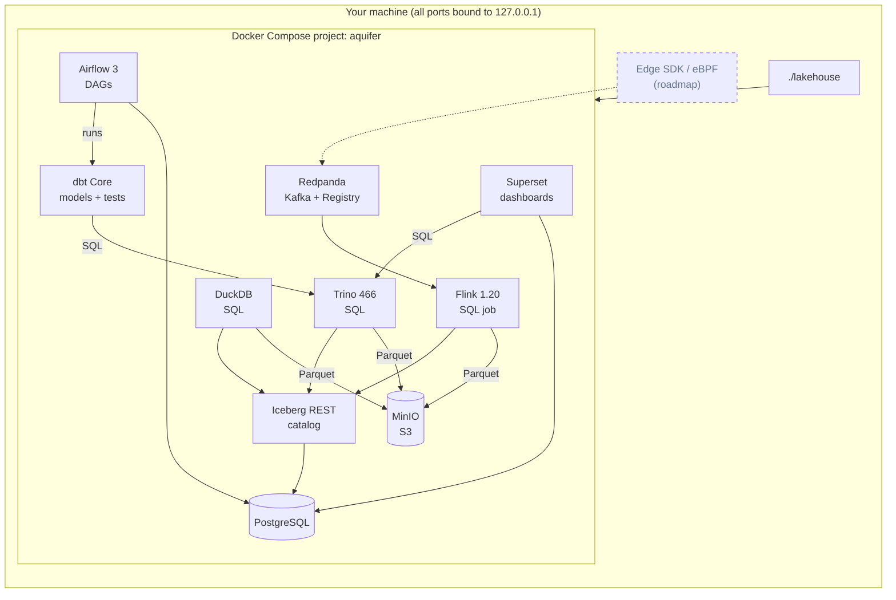

<p align="center">
  
</p>

<p align="center">
  <a href="LICENSE"></a>
  
  
  
  
</p>

<h3 align="center">A sovereign, open-source data platform that runs entirely inside your own walls, starting with your laptop.<br>Lakehouse, scheduler, streaming and BI in one command. No cloud account. No lock-in.</h3>

<p align="center">
  
  <br><sub>This dashboard is what <code>./lakehouse quickstart</code> leaves you with, built from Iceberg tables on your own machine.</sub>
</p>

## Try it in a minute

```sh
git clone <this repository> aquifer && cd aquifer
./lakehouse quickstart            # Windows: lakehouse.cmd quickstart
```

That's it. AQUIFER generates your passwords, finds free ports, starts the platform, waits until every service really answers,
loads a sample shop into Apache Iceberg, builds dashboards on it and opens a home page with live status lights.
The first run also downloads images; after that it is about a minute.

<details>
<summary>What it prints (shortened, from a real run)</summary>

```text
$ ./lakehouse quickstart

     _      ___   _   _  ___  _____  _____  ____
    / \    / _ \ | | | ||_ _||  ___|| ____||  _ \
   / _ \  | | | || | | | | | | |_   |  _|  | |_) |
  / ___ \ | |_| || |_| | | | |  _|  | |___ |  _ <
 /_/   \_\ \__\_\ \___/ |___||_|    |_____||_| \_\

Created .env with generated credentials (.env).
Preflight
  [ ok ] Darwin arm64, Python 3.9.6
  [ ok ] Docker Engine 27.4.0 (Docker Desktop)
  [ ok ] Docker memory 24.4 GB, 12 CPUs
  [ ok ] Compose model is valid
  [ ok ] Trino port 8093 is free   ...
Waiting for services
  [ ok ] Superset (charts, dashboards) is ready
  [ ok ] Airflow scheduler and DAG processor are healthy
  [ ok ] Trino (SQL engine) is ready
  [ ok ] Redpanda Console (Kafka) is ready
  [ ok ] Flink (stream processing) is ready
  [ ok ] MinIO (object storage) is ready
  [ ok ] Flink job aquifer-orders-to-iceberg is running
AQUIFER is ready (37s)
  Superset (charts, dashboards)      http://localhost:8280/
  Airflow (orchestration)            http://localhost:8095/
  Trino (SQL engine)                 http://localhost:8093/ui/
  Flink (stream processing)          http://localhost:8283/
Demo data: Acme Outdoor web shop (synthetic)
    ok table iceberg.shop.orders (1.3s)
  dbt build: staging, marts and tests
    ok dbt build: Done. PASS=25 WARN=0 ERROR=0 SKIP=0 NO-OP=0 TOTAL=25 (7.3s)
  Flink: replaying 600 synthetic order events from the last 6 hours through Kafka
  [ ok ] 600 events landed in iceberg.shop.order_events
Dashboard: http://localhost:8280/superset/dashboard/shop-overview/
Streaming: http://localhost:8280/superset/dashboard/streaming-live/
```

</details>

## Why AQUIFER

Learning or prototyping on a modern data stack usually means a week of Compose files, version conflicts, port clashes and
"works on my machine". AQUIFER is that week, done once, tested, and shipped with a manual.

| Without AQUIFER | With AQUIFER |
| --- | --- |
| Hand-write and debug a dozen service definitions | `./lakehouse quickstart` |
| Default passwords copied from tutorials | Random per-machine credentials in a git-ignored `.env` |
| "Port 9000 is already allocated" | Free ports are chosen for you; `doctor` explains any that clash |
| Services "up" but not ready, flaky first queries | The launcher waits on real readiness probes, not container state |
| Empty tools, then an hour hunting for sample data | A sample shop, dbt marts with tests, a live Flink stream and two dashboards, ready |
| Three setups for macOS, Windows and Linux | One Python launcher, identical commands everywhere |
| A cloud bill for a sandbox | Runs offline once images are pulled |

## What AQUIFER stands for

An aquifer is the deep, natural reservoir that everything else draws from. AQUIFER is the physical substrate for
[FLUID](docs/EXTENSIONS.md)-style data products: a reference architecture built only from open standards and open-source
parts, so it can run on your laptop, in your data center or behind an air gap.

| | Pillar | Component | Status in this repository |
| --- | --- | --- | --- |
| **A** | **A**irflow, orchestration | Apache Airflow 3 | Shipped |
| **Q** | Federated **Q**uery | Trino 466 (cluster SQL) and DuckDB (in-process, on the same tables) | Shipped |
| **U** | **U**niversal open formats | Parquet files and an Iceberg REST catalog on S3-compatible storage | Shipped (open formats; no Unity Catalog) |
| **I** | **I**ceberg tables | Apache Iceberg | Shipped |
| **F** | **F**link stream processing | Apache Flink 1.20: Kafka topic to Iceberg table | Shipped (`streaming` profile, on by default; at-least-once, no dead-letter queue yet) |
| **E** | **E**dge telemetry and masking at the source | FLUID Edge SDK, eBPF | Roadmap. Not included yet |
| **R** | **R**edpanda messaging | Redpanda (Kafka API, Schema Registry) | Shipped |

Transformation standard: **dbt Core** (Trino adapter), run by Airflow and by `./lakehouse dbt`. Also included for a complete
experience: Apache Superset (BI), MinIO (object storage), PostgreSQL (metadata), and optional Prometheus and Grafana. Only
Edge is still a roadmap item; the table above is the source of truth.

### Sovereign by design

- **Everything inside your firewall.** No SaaS control plane, no telemetry, no cloud account. Every component is open source
  or source-available and runs from images you can mirror into your own registry.
- **Offline-capable.** After the images are pulled the stack needs no internet. For air-gapped sites build or pull the images
  once, `docker save` them, `docker load` them inside, and start with `./lakehouse up --no-build`.
- **No lock-in.** Parquet on S3 with an open table format and a standard SQL engine: your data stays readable by any tool.
- **Declarative on top.** The optional `reference` extension deploys a data product defined by a FLUID contract with FLUID
  Forge, on exactly this substrate ([docs/EXTENSIONS.md](docs/EXTENSIONS.md)).

This repository is the local development implementation. Production and regulated deployments need the hardening listed in
[PRODUCTION-READINESS.md](PRODUCTION-READINESS.md): TLS, authentication, authorization, backup and operations.

## What is inside

| Layer | Component | Why it is there |
| --- | --- | --- |
| BI | **Apache Superset** 4.1 | Charts, dashboards and SQL Lab over the lakehouse, seeded and ready |
| Transformation | **dbt Core** 1.10 | The transformation standard: SQL models, tests and lineage, run by Airflow or `./lakehouse dbt` |
| SQL | **Trino** 466 | One fast engine for everything: ad hoc queries, transformations, BI |
| Embedded SQL | **DuckDB** 1.3 | Query the same Iceberg tables from a laptop-friendly in-process engine |
| Tables | **Apache Iceberg** (REST catalog) | Open table format with snapshots, schema evolution and time travel |
| Storage | **MinIO** | S3-compatible object store, so your paths and clients are the real thing |
| Orchestration | **Apache Airflow** 3 | Schedules and DAGs; one runs `dbt build` for the marts |
| Streaming | **Redpanda** + Console + Schema Registry | Kafka API without the Kafka weight |
| Stream processing | **Apache Flink** 1.20 | A SQL job that lands the Kafka topic `shop.orders` in an Iceberg table |
| Metadata | **PostgreSQL** | Catalog, Airflow and Superset state in one place |
| Optional | **Prometheus + Grafana**, **Spark** | Platform and Flink dashboards; a bounded Spark check |

Everything is pinned to specific versions and published only on `127.0.0.1`.

## Built for humans

- **Zero-config start.** `quickstart` creates `.env`, picks free ports, runs the preflight and starts everything.
- **`doctor` tells you what is wrong and how to fix it.** Docker missing or asleep, Compose too old, not enough memory, a port
  taken (and by which container), a broken config. Each failure comes with the exact fix.
- **A real readiness model.** Trino must report `starting: false`, Airflow's scheduler and DAG processor must be healthy,
  Superset must answer. No more "it said started but the first query failed".
- **Querying is one word.** `./lakehouse sql` opens a Trino shell, or `./lakehouse sql "SELECT ..."` prints a table, CSV or
  JSON. It needs no driver installed.
- **`connect` hands you the settings for your tools.** JDBC URL for DBeaver, a Python snippet, a dbt profile, S3 endpoint
  and Kafka bootstrap, filled in with your actual ports.
- **Safe to experiment.** `down` keeps your data, `reset` wipes it (after asking), `check` proves the whole platform works.
- **Same everywhere.** macOS, Windows (cmd, PowerShell, WSL) and Linux share one implementation, and CI is set up to run its
  unit tests on all three.
- **Nothing hidden.** Everything is plain Docker Compose underneath; `./lakehouse compose ...` runs any Compose command for
  your project.

<p align="center">
  
  <br><sub>The generated home page: every service, its address and a live status light (<code>./lakehouse open</code>).</sub>
</p>

## Get started

### 1. Prerequisites (once)

You need **Docker with Compose v2** and **Python 3.8+** (only for the tiny launcher).

| Platform | Check or install |
| --- | --- |
| macOS | `./setup.sh` (add `--install` for Homebrew) |
| Ubuntu / Debian | `./setup.sh` (add `--install` for apt; asks before using `sudo`) |
| Windows 10/11 | `setup.cmd` (add `-Install` for winget); Docker Desktop with WSL 2 |

The setup scripts only check and explain unless you pass the install flag, and they never install silently. Details,
Colima/OrbStack, WSL and proxy notes: [docs/INSTALL.md](docs/INSTALL.md).

### 2. Start

```sh
./lakehouse quickstart
```

Prefer step by step? `./lakehouse init`, `./lakehouse doctor`, `./lakehouse up`, `./lakehouse demo`.

### 3. Explore

```sh
./lakehouse open dashboard           # the seeded Superset dashboard
./lakehouse sql                      # Trino shell on your Iceberg tables
./lakehouse sql "SELECT country, round(sum(net_revenue)) AS revenue
                 FROM shop.daily_revenue GROUP BY 1 ORDER BY 2 DESC"
./lakehouse info                     # all URLs and logins (--show-secrets for passwords)
./lakehouse connect                  # settings for DBeaver, Python, dbt, S3, Kafka
```

## The demo: Acme Outdoor

A fully synthetic web shop, generated with plain Trino SQL (no downloads, deterministic), transformed with dbt and fed live
through Kafka and Flink:

| Layer | What | Built by |
| --- | --- | --- |
| Raw | `customers` (5,000), `products` (48), `orders` (30,000) in `iceberg.shop` | `demo/sql/01_seed.sql` |
| Marts | `orders_enriched`, `daily_revenue`, `customer_value`, `monthly_cohorts`, with 23 dbt tests | dbt project `dbt/`; Airflow DAG `shop_marts` |
| Stream | `order_events` (Kafka topic `shop.orders` through Flink) and the mart `live_orders_by_hour` | Flink job `flink/sql/orders_stream.sql`; DAG `shop_streaming_marts` |
| BI | Two dashboards (16 charts) and four saved SQL Lab queries | `analytics/bootstrap.py` |

Break it, change it, make it yours: edit a dbt model, run `./lakehouse dbt build`, refresh the dashboard; send 500 more events
with `./lakehouse stream --events 500` and watch the streaming dashboard move. Walkthrough: [docs/DEMO.md](docs/DEMO.md);
how the pieces connect: [docs/PIPELINES.md](docs/PIPELINES.md).

<p align="center">
  
  <br><sub>Order events travelling Kafka, Flink and Iceberg, charted in Superset (<code>./lakehouse stream</code> adds more).</sub>
</p>

## Recipes

<details>
<summary><b>Query from your favourite tool</b></summary>

`./lakehouse connect` prints these with your real ports:

```text
JDBC URL   jdbc:trino://localhost:8093/iceberg        (DBeaver, DataGrip, IntelliJ; any user name, no password)
Python     pip install trino
           from trino.dbapi import connect
           cur = connect(host="localhost", port=8093, user="me", catalog="iceberg", schema="shop").cursor()
dbt        pip install dbt-trino  (profile snippet is printed by the command)
S3         http://localhost:9000 (path style), access key and secret from .env
```

</details>

<details>
<summary><b>Stream events: Kafka to Flink to Iceberg</b></summary>

```sh
./lakehouse stream --events 500 --rate 50   # 50 order events per second to the Kafka topic shop.orders
./lakehouse flink                           # the job aquifer-orders-to-iceberg, state RUNNING
./lakehouse sql "SELECT status, count(*) FROM shop.order_events GROUP BY 1"
```

Flink checkpoints every 10 seconds, so events are queryable in Trino, DuckDB and Superset about 10 to 20 seconds after they are
produced. Browse the topic in Redpanda Console (`./lakehouse open console`) and the job in the Flink UI (`./lakehouse open flink`).

</details>

<details>
<summary><b>Transform with dbt Core</b></summary>

```sh
./lakehouse dbt build                       # models and tests (the default)
./lakehouse dbt run --select daily_revenue  # any dbt command
./lakehouse dbt test
```

The project is the `dbt/` folder, mounted into the Airflow image, so edits on your machine apply immediately. dbt runs on Trino
and writes Iceberg tables. To run dbt from your own machine: `pip install dbt-trino`, `export TRINO_HOST=localhost
TRINO_PORT=<your Trino port>` and `dbt build --project-dir dbt --profiles-dir dbt`.

</details>

<details>
<summary><b>Query the same tables with DuckDB</b></summary>

```sh
./lakehouse duckdb "SELECT country, round(sum(net_revenue)) AS revenue FROM lake.shop.daily_revenue GROUP BY 1 ORDER BY 2 DESC"
./lakehouse duckdb                          # interactive shell; the Iceberg catalog is attached as `lake`
```

Trino and DuckDB read the same Parquet files through the same Iceberg REST catalog; nothing is copied.

</details>

<details>
<summary><b>Produce to Kafka by hand</b></summary>

```sh
./lakehouse compose exec -T redpanda rpk topic create shop-events
echo '{"order_id": 1, "amount": 59.90}' | ./lakehouse compose exec -T redpanda rpk topic produce shop-events
./lakehouse compose exec -T redpanda rpk topic consume shop-events -n 1
```

</details>

<details>
<summary><b>Create your own table and chart it</b></summary>

```sql
CREATE TABLE iceberg.shop.top_customers WITH (format = 'PARQUET') AS
SELECT customer_id, net_revenue FROM iceberg.shop.customer_value ORDER BY net_revenue DESC LIMIT 100;
```

In Superset: **Datasets > + Dataset**, choose the *Lakehouse (Trino, general)* connection, schema `shop`, your table, then
**Charts > + Chart**. Iceberg gives you time travel for free: `SELECT * FROM shop."orders$snapshots"`.

</details>

<details>
<summary><b>Run something on a schedule</b></summary>

Drop a Python DAG into `airflow/dags/` (see `shop_marts.py` for a 25-line example that runs `dbt build`). Airflow lists
the folder every few minutes, then unpause and trigger it in the UI (`./lakehouse open airflow`).

</details>

<details>
<summary><b>Add monitoring or Spark</b></summary>

```sh
./lakehouse up --with observability     # Prometheus + Grafana: service readiness and Flink job health
./lakehouse up --with spark             # then ./lakehouse spark-check for the bounded Spark streaming check
```

</details>

## Command cheat sheet

Works identically as `./lakehouse` (macOS, Linux, WSL) and `lakehouse.cmd` (Windows). `make <target>` is a shortcut on
macOS and Linux.

| Command | What it does |
| --- | --- |
| `quickstart` | First run: init, preflight, start, demo, home page |
| `up [--with ...] [--demo] [--open]` | Build and start, then wait until really ready |
| `down` / `reset [--yes]` | Stop and **keep** data / **delete** all data |
| `status` | Containers plus a probe of every endpoint (non-zero exit if something is down) |
| `info`, `connect`, `open [service]` | URLs and logins; tool settings; open a page in your browser |
| `sql ["query"] [-f file] [--format table\|csv\|json]` | Run SQL on Trino or start a shell |
| `duckdb ["query"]` | DuckDB shell (or one query) on the same Iceberg tables, catalog attached as `lake` |
| `dbt [args]` | Run dbt Core in the Airflow image (default: `build` the shop project, tests included) |
| `stream [--events N] [--rate R]` | Send order events through Kafka and Flink into Iceberg and wait until they land |
| `flink [sql]` | Show Flink jobs, or open the Flink SQL client |
| `demo` | Load the sample shop, run dbt, replay events through Flink, seed the dashboards (safe to repeat) |
| `load FILE [--table schema.name] [--replace]` | Load a CSV, TSV or JSON-lines file into an Iceberg table (types inferred, default `data.<file name>`) |
| `backup [FILE]` / `restore FILE` | Archive all data volumes and `.env` into one file / replace the data with a backup |
| `logs [service]`, `restart [service]` | Follow logs; restart |
| `doctor` | Check Docker, memory, ports and configuration, with fixes |
| `check` | Full acceptance run: endpoints, Iceberg round trip, dbt tests, DuckDB, Kafka to Flink to Iceberg, every chart |
| `test`, `lint` | Unit tests without Docker; validate the compose model |
| `compose <args>` | Any `docker compose` command with this project's settings |

More: `smoke`, `analytics-check`, `catalog-restore-check`, `security-check`, `spark-check`, `pattern`. See
`./lakehouse --help`. The older `./up.sh --doctor` style flags still work.

## How it fits together



Solid lines ship today; the dashed box is on the roadmap. Trino and DuckDB read the same Iceberg tables, so engines can be swapped
without moving files. Architecture notes,
data flow and design decisions: [docs/ARCHITECTURE.md](docs/ARCHITECTURE.md).

## AQUIFER vs. the alternatives

| | AQUIFER | DIY Compose from tutorials | DuckDB alone | Cloud sandbox |
| --- | --- | --- | --- | --- |
| One command start | Yes | No | Yes | Sign-up and setup |
| Lakehouse (Iceberg + catalog + object store) | Yes | If you build it | No | Yes |
| Orchestration, BI and streaming included | Yes | If you build them | No | Usually extra |
| Works offline | Yes (after first pull) | Yes | Yes | No |
| Cross-platform launcher and doctor | Yes | No | n/a | n/a |
| Footprint | About 4 GB RAM | Varies | Tiny | None locally |
| Costs money | No | No | No | Yes |

DuckDB is wonderful for single-process analytics, which is why it is part of AQUIFER. Reach for the whole stack when you want the
platform shape (catalog, object store, orchestration, dbt, streaming, BI) to learn, prototype or test against.

## Requirements

| | Minimum | Comfortable |
| --- | --- | --- |
| Docker memory | 7 GB | 8 GB or more (`preset: medium` wants 16 GB) |
| CPUs | 4 | 6+ |
| Free disk | 15 GB | 25 GB |
| Docker | Compose v2.20+ (Docker Desktop, Colima, OrbStack or Engine) | Docker Desktop current |
| Python | 3.8 | 3.10+ |
| OS | macOS (verified on Apple Silicon), Windows 10/11 with WSL 2, Ubuntu and other current Linux; see [platform status](docs/INSTALL.md#platform-status) | |

After `quickstart` the containers use roughly 4 GB. `./lakehouse doctor` checks all of this.

## Configuration

Three layers, later wins: `pattern.yaml` (shared defaults) < `.env` (your machine, git-ignored) < environment variables.

```yaml
# pattern.yaml
preset: small            # or medium
profiles: [analytics, streaming]   # also: observability, spark, notebook
extensions: []           # optional compose layers (docs/EXTENSIONS.md)
```

Ports, memory limits and credentials: [docs/CONFIGURATION.md](docs/CONFIGURATION.md). Second copy side by side: set
`COMPOSE_PROJECT_NAME` in `.env`.

## FAQ

**Is this for production?** No. It is a development and learning platform: loopback only, generated passwords, but no TLS,
no real Trino authentication, only manual backups. Read [PRODUCTION-READINESS.md](PRODUCTION-READINESS.md) before you put anything
sensitive anywhere near it.

**Does it need internet?** For the first run, to pull images and packages. Afterwards it runs offline.

**Will it eat my laptop?** Every container has a memory cap; about 4 GB is in use once running. `./lakehouse down` frees it,
and your data stays in Docker volumes.

**How do I start from scratch?** `./lakehouse reset --yes`, then `./lakehouse quickstart`.

**Can I bring my own data?** Yes: `./lakehouse load demo/data/support_tickets.csv` turns a CSV, TSV or JSON-lines file into an
Iceberg table (`data.support_tickets`) with inferred types, ready for Trino, DuckDB and Superset. Or create tables with SQL
(`CREATE TABLE ... AS SELECT`).

**Notebooks?** `./lakehouse up --with notebook` adds JupyterLab with pandas, PyIceberg and DuckDB preconfigured against the lakehouse;
`./lakehouse open notebook` opens it (a welcome notebook is in `notebooks/`).

**Can I back it up?** `./lakehouse backup` writes one file with all data volumes; `./lakehouse restore FILE` brings it back.

**Why Python for the launcher?** One implementation to test on macOS, Linux and Windows. It uses only the standard library
(plus PyYAML, installed into a private folder on first use).

**Windows?** Use `lakehouse.cmd` from cmd.exe or PowerShell, with Docker Desktop on WSL 2. The unit tests run on Windows in
CI; the maintainers have not yet exercised the Windows scripts on a physical machine, so please report problems.

**Something is wrong.** Run `./lakehouse doctor`, then see [docs/TROUBLESHOOTING.md](docs/TROUBLESHOOTING.md).

## Roadmap

- **Flink next steps:** exactly-once upserts, a dead-letter queue for bad events, and a catalog of reusable SQL jobs
- **E: Edge** telemetry and masking at the source through the FLUID Edge SDK and eBPF
- More sample datasets
- Optional authentication and TLS profile for Trino
- Apple Silicon, Windows and Linux CI matrix for the full stack

Ideas and votes welcome in issues.

## Docs

| | |
| --- | --- |
| [docs/INSTALL.md](docs/INSTALL.md) | Prerequisites per platform, proxies, alternatives |
| [docs/CONFIGURATION.md](docs/CONFIGURATION.md) | `pattern.yaml`, `.env`, ports, presets, profiles |
| [docs/ARCHITECTURE.md](docs/ARCHITECTURE.md) | Services, data flow, security posture |
| [docs/DEMO.md](docs/DEMO.md) | The sample shop and how to build on it |
| [docs/PIPELINES.md](docs/PIPELINES.md) | dbt, Flink and DuckDB: how data flows, how to extend it |
| [docs/EXTENSIONS.md](docs/EXTENSIONS.md) | Optional layers, including the Customer Profile 360 data-product reference |
| [docs/TROUBLESHOOTING.md](docs/TROUBLESHOOTING.md) | Symptoms and fixes |
| [docs/THIRD-PARTY.md](docs/THIRD-PARTY.md) | Licenses of the software AQUIFER orchestrates |
| [CONTRIBUTING.md](CONTRIBUTING.md) | How to help |

## Contributing

Issues and pull requests are welcome. `make test` runs the unit tests without Docker; `./lakehouse check` runs the full
acceptance suite. See [CONTRIBUTING.md](CONTRIBUTING.md).

## License

[MIT](LICENSE). AQUIFER's own code is MIT licensed. It orchestrates third-party software under its own licenses (Apache-2.0, AGPL,
Redpanda's source-available terms and others) that is pulled at run time, not redistributed; see
[docs/THIRD-PARTY.md](docs/THIRD-PARTY.md).
