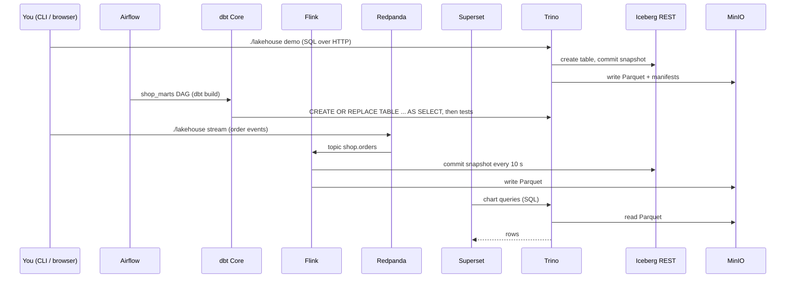

# Architecture

AQUIFER is the physical substrate for FLUID-style data products: **A**irflow orchestration, federated **Q**uery with Trino,
**U**niversal open formats (Parquet on S3-compatible storage), **I**ceberg tables, **F**link stream processing, **E**dge
telemetry and **R**edpanda messaging. Airflow, Trino (plus DuckDB), Parquet and Iceberg, Flink and Redpanda ship in this repository;
Edge is a roadmap item (see the status table in the [README](../README.md#what-aquifer-stands-for)). **dbt Core** is the
transformation standard. Apache Superset, MinIO and PostgreSQL complete the local platform.

## Services

| Service | Image | Role | Host port (default) |
| --- | --- | --- | --- |
| `postgres` | postgres 16.6 | Metadata for Airflow, Superset and the Iceberg JDBC catalog (separate roles and databases) | none |
| `minio` + `storage-init` | MinIO 2025-04-22 | S3-compatible object store; buckets `warehouse`, `checkpoints`, `quarantine`, `artifacts` created idempotently | 9000 API, 9001 console |
| `iceberg-rest` | tabulario/iceberg-rest 1.6.0 | Iceberg REST catalog backed by PostgreSQL, data in MinIO | none |
| `trino` | trinodb/trino 466 | SQL engine; `iceberg` catalog over the REST catalog and S3 | 8093 |
| `duckdb` | local build of DuckDB 1.3.2 CLI | In-process SQL on the same Iceberg tables (`httpfs` and `iceberg` extensions baked in); used through `./lakehouse duckdb` | none |
| `redpanda` + `console` | Redpanda 24.3, Console 2.8 | Kafka API, Schema Registry, web UI | 19092 Kafka, 18081 registry, 8094 console |
| `airflow-*` | local build of Airflow 3.3.2 | API server, scheduler (LocalExecutor), DAG processor; Trino client, boto3 and an isolated dbt Core with the Trino adapter (project in `dbt/`) | 8095 |
| `superset` (+ init jobs) | local build of Superset 4.1.1 | BI; Trino driver; seeded by `analytics/bootstrap.py` | 8280 |
| `flink-jobmanager`, `flink-taskmanager`, `flink-submit`, `topics-init` | local build of Flink 1.20.1 (Iceberg 1.7.1, Kafka and Hadoop client jars) | Streaming profile: SQL job Kafka `shop.orders` to Iceberg `shop.order_events`; the one-shot containers create the topic and submit the job idempotently | 8283 UI |
| `prometheus`, `blackbox`, `grafana` | official | Optional monitoring: readiness probes and Flink job metrics | 8290, 8291 |
| `spark` | Apache Spark 3.5.3 | Optional bounded Spark streaming check (`spark` profile) | none |
| `notebook` | local build of JupyterLab 4.3.5 | Optional notebooks with pandas, PyIceberg and DuckDB wired to the catalog, Trino and MinIO (`notebook` profile) | 8284 |

All host ports bind to `127.0.0.1` and can be changed in `.env`.

## Data flow

Trino, Flink and DuckDB all talk to the same Iceberg REST catalog and the same object store, so an engine can be swapped or
added without moving files. Superset, Airflow and dbt speak SQL to Trino.

## Storage and state

Named Docker volumes (prefix = project name): `postgres_data`, `minio_data`, `redpanda_data`, `airflow_home`, `airflow_logs`,
`superset_home`, `prometheus_data`, `grafana_data`, `spark_checkpoints`. `./lakehouse down` keeps them; `./lakehouse reset`
removes them. The Iceberg catalog metadata (PostgreSQL) and the data files (MinIO) are separate, so a catalog backup alone is
not a data backup; `./lakehouse catalog-restore-check` proves only that catalog registrations restore.

`./lakehouse backup` stops the stack, archives `postgres_data`, `minio_data`, `redpanda_data`, `airflow_home` and `superset_home`
(plus `.env`) into one tar file and starts the stack again; `./lakehouse restore FILE` replaces those volumes. Backups are file
copies of a quiesced stack, so they are consistent but not incremental, and they contain credentials.

## The launcher

`lakehouse.py` is a single standard-library Python file (PyYAML is installed into `.pattern/venv` on first use). It does not
hide anything: every action is a `docker compose` call you can reproduce with `./lakehouse compose ...`. It

1. renders `pattern.yaml` into `.pattern/` (defaults, Trino JVM config, resolved settings),
2. merges `.env` and the environment,
3. selects compose files (`compose.yaml`, enabled extensions, `.pattern/compose.yaml`) and profiles,
4. runs preflight checks, starts the stack and waits on real readiness probes (Trino `starting: false`, Airflow component
   health, HTTP 200 elsewhere),
5. talks to Trino directly over its HTTP protocol for `sql`, `demo` and `check`, so it needs no driver and no `docker exec`.

`lakehouse` (POSIX shell) and `lakehouse.cmd` (Windows) only locate a Python 3.8+ interpreter and run it.

## Security posture

- Loopback-only ports, non-root users where the images allow it, dropped Linux capabilities, `no-new-privileges`, per-service
  memory caps and log rotation.
- Admin passwords and Superset's secret key are generated per machine into `.env` (mode 600 on POSIX, git-ignored).
- Not provided: TLS, Trino authentication, per-user access control, backup, encryption at rest, network policy between
  services. `./lakehouse security-check` validates an isolated TLS and password candidate of Trino (macOS, Linux, WSL) as a
  step toward hardening; it does not change the default endpoint. See [../PRODUCTION-READINESS.md](../PRODUCTION-READINESS.md).

## Design decisions

- **Iceberg REST catalog + Trino** rather than Hive Metastore: simple, engine-neutral, one process plus PostgreSQL.
- **Redpanda** supplies a Kafka-compatible broker and Schema Registry in one lightweight container.
- **Superset's metadata in the shared PostgreSQL** to avoid another database.
- **Python launcher instead of shell and PowerShell twins**: one implementation to test on all platforms.
- **Pattern file instead of many flags**: `pattern.yaml` is validated and versioned, so team defaults are reviewable.
- **Extensions as Compose layers** keep company-specific integrations out of the generic core.
