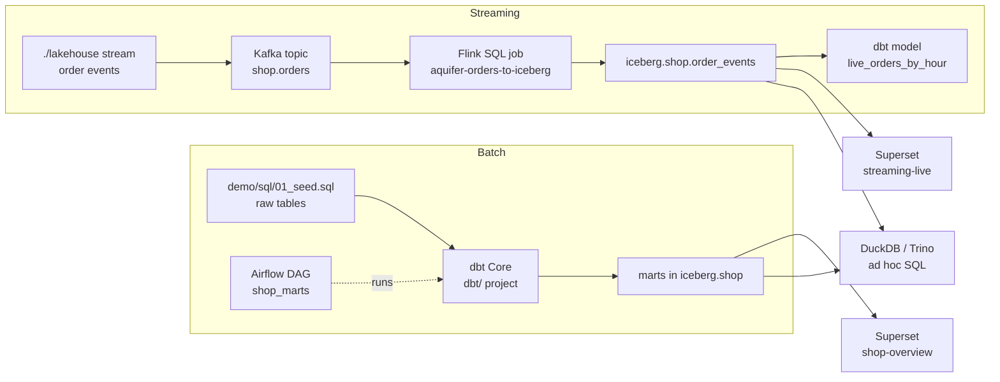

# Pipelines: dbt, Flink and DuckDB

AQUIFER ships one batch pipeline and one streaming pipeline over the same Iceberg lakehouse. Both are small on purpose so you can
read them in one sitting and copy the pattern.



## dbt Core: the transformation standard

All transformations are dbt models in [`dbt/`](../dbt). The project runs on **Trino** through `dbt-trino`, inside the Airflow image
(an isolated virtualenv, so dbt's dependencies never collide with Airflow's). The folder is mounted read-only into the container,
so you edit models on your machine and the next run uses them.

| Path | Purpose |
| --- | --- |
| `dbt/dbt_project.yml` | Project settings: tables stored as Parquet, `CREATE OR REPLACE`, the `streaming` tag for `models/streaming` |
| `dbt/profiles.yml` | Connection to Trino (`TRINO_HOST` and `TRINO_PORT` from the environment) |
| `dbt/models/sources.yml` | The raw `shop` tables with tests (unique, not null, relationships, accepted values) |
| `dbt/models/intermediate/` | `orders_enriched`: orders joined with customers and products |
| `dbt/models/marts/` | `daily_revenue`, `customer_value`, `monthly_cohorts` |
| `dbt/models/streaming/` | `live_orders_by_hour`, built from the events Flink lands |
| `dbt/tests/` | Singular tests (retention between 0 and 1, net revenue never above gross) |

```sh
./lakehouse dbt build                          # all models and tests except the streaming mart (the default)
./lakehouse dbt build --select tag:streaming   # the streaming mart
./lakehouse dbt run --select daily_revenue+    # one model and everything downstream
./lakehouse dbt test
```

Airflow runs the same commands: the DAG `shop_marts` (daily) builds everything except the streaming mart and
`shop_streaming_marts` (hourly) builds the streaming mart. Both are paused until you unpause them in the Airflow UI.

Notes:

- Models are tables, not views: the Iceberg REST catalog used here does not store views.
- dbt writes its `target/` and logs to `/tmp` inside the container, so the mounted project stays clean.
- To run dbt from your own machine use `pip install dbt-trino`, set `TRINO_HOST=localhost` and `TRINO_PORT` to your Trino port
  (`./lakehouse connect` prints it) and run `dbt build --project-dir dbt --profiles-dir dbt`.

## Flink: Kafka to Iceberg

The `streaming` profile (on by default in `pattern.yaml`) starts a Flink 1.20 session cluster: one JobManager (UI on the
printed Flink port), one TaskManager with two slots, and a one-shot `flink-submit` container that submits the job.

The job is plain Flink SQL in [`flink/sql/orders_stream.sql`](../flink/sql/orders_stream.sql):

1. creates an Iceberg catalog `lake` on the REST catalog and MinIO,
2. creates `lake.shop.order_events` if it does not exist,
3. declares the Kafka source `shop.orders` (JSON, ISO-8601 event time, Kafka partition and offset as metadata columns),
4. runs `INSERT INTO lake.shop.order_events SELECT ... FROM kafka_orders` and stamps each row with its ingestion time.

Behaviour worth knowing:

- **Delivery.** The job checkpoints every 10 seconds, and the Iceberg sink commits on each checkpoint, so events become visible
  10 to 20 seconds after they are produced. Delivery is at-least-once: after a restart the job resumes from the committed
  Kafka offsets and can re-deliver the events of the last uncommitted checkpoint. `kafka_partition` and `kafka_offset` are
  stored so you can deduplicate.
- **Idempotent submit.** `./lakehouse up` always runs `flink-submit`; it does nothing when the job is already running and
  resubmits it after `down`/`up`.
- **Bad events.** Records that are not valid JSON are skipped (`json.ignore-parse-errors`). A dead-letter queue is on the roadmap.
- **State.** Checkpoints live in the container (`/tmp`); this is a development setup, not a recovery design.
- **Schema.** `order_events` has `event_id`, `order_id`, `customer_id`, `product_id`, `quantity`, `amount`, `status`,
  `event_time`, `kafka_partition`, `kafka_offset` and `ingested_at`.

```sh
./lakehouse flink                       # job state and the UI address
./lakehouse flink sql                   # Flink SQL client (SHOW JOBS; ...)
./lakehouse stream --events 1000 --rate 100
./lakehouse logs flink-taskmanager
```

To add a job: write another SQL file in `flink/sql/`, copy `flink/submit.sh` for it (or extend it to loop over files) and add the
service to `compose.yaml`. Jars for Kafka, Iceberg, AWS S3 and Hadoop configuration classes are baked into the image
(`flink/Dockerfile`, versions pinned, SHA-1 verified).

## DuckDB: the same tables, in process

The `duckdb` container runs the DuckDB CLI with the `httpfs` and `iceberg` extensions preinstalled (no download at run time).
`./lakehouse duckdb` starts it with the Iceberg REST catalog attached as `lake` and MinIO credentials configured:

```sh
./lakehouse duckdb "SELECT count(*) FROM lake.shop.orders"
./lakehouse duckdb                      # interactive: SHOW ALL TABLES; SELECT * FROM lake.shop.daily_revenue LIMIT 5;
./lakehouse duckdb --format json "SELECT * FROM lake.shop.order_events LIMIT 3"
```

DuckDB reads the Parquet files that Trino and Flink wrote, through the same catalog, so there is no copy and no export step.
Use it when you want fast local analytics, to cross-check a Trino result, or to try the Iceberg support of another engine. It is
attached read-oriented: write your tables with Trino or dbt.

## Verifying everything

`./lakehouse check` runs, in order: endpoint probes, an Airflow to Trino to Iceberg round trip, the dbt tests, a DuckDB read of
the Iceberg tables, a Kafka to Flink to Iceberg round trip with 100 fresh events, and every dashboard chart through Trino.
CI runs the same command on a Linux runner.
